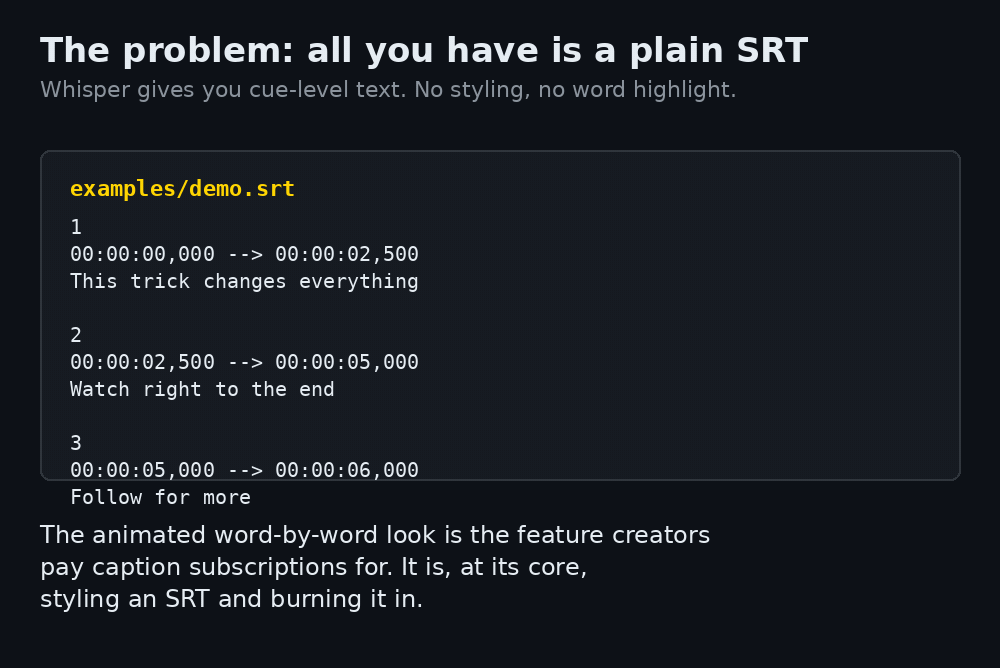

<h1 align="center">shorts-caption-studio</h1>

<p align="center"><strong>The animated word-by-word captions — burned in locally, free, from your SRT.</strong></p>

<p align="center">
  
  
  
  
  
</p>



<p align="center"><em>Real runs on the bundled example: the plain SRT, the styled sidecar, frames from the actual render, and the honesty check on a broken SRT.</em></p>

The captions that make Shorts hold attention — each word lighting up as it's spoken — are the headline feature of the paid caption tools. Submagic's Starter plan is **$19/month for 15 videos** (2 minutes each), and your unreleased video uploads to their cloud to get them (pricing: [Facts this tool relies on](#facts-this-tool-relies-on)). Underneath, the job is styling an SRT file and burning it into the video — and that core job runs fine on your own machine.

`shorts-caption-studio` does it locally. Give it a transcript (a Whisper SRT is fine) and a vertical video, and it renders the highlight captions in — three styles, `pop`, `karaoke` and `clean` — or hands you just the styled `.ass` sidecar for your own editor or pipeline. No upload, no subscription, no video quota. Your unreleased footage never leaves your machine.

## Quick start

```bash
pipx install git+https://github.com/jasveerai88/shorts-caption-studio
# or: pip install git+https://github.com/jasveerai88/shorts-caption-studio

# from a clone, so the bundled examples are on disk:
python3 examples/make_examples.py   # once: generates examples/demo.mp4 (needs ffmpeg)
shorts-caption-studio examples/demo.mp4 --captions examples/demo.srt
```

```text
shorts-caption-studio v1.0.0 — render
Video: demo.mp4 (720x1280, 6.0s)
Captions: demo.srt — 3 cues, 12 words
Style: pop (big bold, active word in accent colour at 120% scale) · PlayRes 1080x1920
Word timing: ESTIMATED (cue duration split by word length — not true word alignment)
Rendered: examples/demo.captioned.mp4 (12 caption events burned in)
(exit code: 0)
```

Don't want the video touched? `--ass-only` emits just the styled sidecar — pure Python, no ffmpeg needed:

```bash
shorts-caption-studio --ass-only examples/demo.srt -o demo.pop.ass --style pop
```

## What it does

| Mode | What you give it | What you get | On the bundled example |
|---|---|---|---|
| Burn-in (default) | a video + its SRT | a new `.mp4` with the captions rendered in (input never overwritten) | `demo.mp4` + `demo.srt` → `demo.captioned.mp4`, 12 caption events |
| `--ass-only` | an SRT | a styled `.ass` sidecar for your own editor/renderer | `demo.srt` → 12 events (`pop`) · 3 events (`karaoke`) · 3 events (`clean`) |

| Style | Look | How it renders |
|---|---|---|
| `pop` | Big bold white words; the spoken word pops to accent yellow at 120% scale | one event per word, active word wrapped in colour + scale tags |
| `karaoke` | Each word fills from light grey to accent yellow as it's spoken | one event per cue, per-word `\kf` sweep tags (centisecond durations) |
| `clean` | Minimal plain white, no highlight, no animation | one event per cue, MarginV 460 — bottom-third safe area |

All styles are composed for vertical video (PlayRes 1080x1920) with margins that keep captions out of the Shorts UI zones — the bottom 380px where captions/CTAs sit, and the top 220px title area.

**How it compares** (the caption step only — the paid tools are full editors, see Honest limits):

| | shorts-caption-studio | Submagic (Starter) |
|---|---|---|
| Price | free, MIT | $19/member/month billed monthly ($12 billed yearly) — 15 videos, 2 min each |
| Where your video goes | nowhere — it never leaves your machine | uploaded to their cloud |
| Transcription | **none — you bring an SRT** | built in (AI auto captions) |
| Word timing | ESTIMATED split of cue timing, labelled as such | word-level, from its transcription |
| Styles | 3 (pop / karaoke / clean) | template library |
| Scriptable | CLI + `--json` + exit codes, runs offline | web app / API on paid tiers |

Prices read from Submagic's pricing page, checked 2026-11-04 — see [Facts](#facts-this-tool-relies-on).

**Reference:** [Honest limits](#honest-limits-the-short-version) · [How burn-in works](#how-burn-in-works) · [Usage](#usage) · [Facts this tool relies on](#facts-this-tool-relies-on) · [For agents](#for-agents) · [Real runs](#real-runs-verbatim) · [Tests](#tests) · [Known limits](#known-limits) · [Privacy](#privacy) · [Contributing](#contributing) · [Related](#related)

## Honest limits (the short version)

- **It does not transcribe.** There is no speech recognition in this tool. You bring an SRT transcript (Whisper, your editor's export, anything cue-level); if you don't have one yet, get one first — this tool starts where transcription ends.
- **Word timing is ESTIMATED — the tool's central honesty rule.** Whisper-style SRTs carry timing per *cue*, not per word. The word timings inside a cue are therefore estimated: each cue's duration is split proportionally to word length (longer word = longer on screen). It looks like real word timing and works well for short, punchy cues — but it is *not* true word-level alignment, and every report (text and JSON) says so. For frame-accurate timing, run a word-level aligner upstream first.
- **SRT in, `.ass` or burned video out.** It reads SRT only — no VTT, no SRT→VTT conversion, no caption-format converting at all. The sidecar it writes is ASS (the format the styling lives in), and the other output is the rendered video itself.
- **No timing repair, no retiming, no offset shifting.** Cues are rendered at the times the SRT states. A cue that cannot be used — empty text, or end ≤ start — is **skipped with a named warning** and exit code 1 (see the messy run under [Real runs](#real-runs-verbatim)); it is never silently dropped and never rendered wrong. If *no* cue is usable, that's an error (exit 2) and nothing is written.
- **Burn-in needs ffmpeg + ffprobe on your PATH** and re-encodes the video (the audio stream is copied untouched). `--ass-only` is pure Python and works without them.
- **Vertical-first.** Styles are composed for 1080x1920. Landscape input renders with a warning, but caption placement is not optimised for it.
- **One look per style.** The font is Arial (libass falls back to a system sans where Arial is absent); there is no per-word font or colour customisation yet. Inline SRT tags (`<i>`, `<b>`) are stripped rather than converted to ASS styling.

## How burn-in works

The tool probes the video with ffprobe (frame size, duration, audio), generates a styled `.ass` file for the chosen style, and renders through ffmpeg's `subtitles` filter pointed at that file. The explicit styled `.ass` is deliberate — the filter silently ignores `force_style`, so generators that rely on it ship unstyled captions without noticing.

The input video is never overwritten: `--out` pointing at it is refused. A failed render deletes any partial output — the tool never leaves a fake success behind. Script-friendly exit codes throughout: `0` = clean, `1` = done with warnings (skipped cues, non-vertical video, captions overrunning the video), `2` = error (clean `ERROR:` message, never a traceback).

## Usage

You need Python 3.10+. Burn-in also needs [ffmpeg](https://ffmpeg.org) (with ffprobe) on your PATH.

```bash
# 1. Burn captions into a video (writes demo.captioned.mp4 beside it)
python3 examples/make_examples.py   # once: generates examples/demo.mp4
shorts-caption-studio examples/demo.mp4 --captions examples/demo.srt

# 2. Pick a style, choose the output name
shorts-caption-studio examples/demo.mp4 --captions examples/demo.srt --style karaoke --out final.mp4

# 3. Or emit just the styled .ass sidecar (no ffmpeg needed)
shorts-caption-studio --ass-only examples/demo.srt -o demo.pop.ass --style pop

# 4. Broken-cue check: skipped cues are named, exit code 1
shorts-caption-studio --ass-only examples/messy.srt -o messy.pop.ass --style pop
```

From a checkout, with no install: `python3 src/shorts_caption_studio.py …` (Python 3.10+, standard library only).

## Facts this tool relies on

Stated narrowly, with the one external comparison this README makes:

| Fact | Source |
|---|---|
| Submagic Starter: **$19/member/month** billed monthly, **$12/member/month** billed yearly; 45 credits = **15 videos**/month, max **2 min** per video, 1080p export, no watermark. Pro $39/mo (40 videos, 5 min), Business $69/mo (100 videos, 30 min) | Submagic pricing page — submagic.co/pricing, read 2026-11-04 |

Everything else in this README is the tool's own behaviour on its bundled examples, reproduced verbatim under [Real runs](#real-runs-verbatim). What is deliberately **not** claimed anywhere in this project: that the estimated word split is accurate timing, or that three styles compete with a full editor's template library, transcription, B-roll and publishing features — they don't, and the comparison table above is scoped to the caption step for that reason.

## For agents

Both modes take `--json`: one JSON object with the same counts, warnings and exit codes as the text report (errors come back as `{"error": ...}`, argparse usage errors included):

```bash
shorts-caption-studio examples/demo.mp4 --captions examples/demo.srt --style karaoke --json
shorts-caption-studio --ass-only examples/demo.srt -o demo.ass --json
```

Common fields: `tool` (`"shorts-caption-studio"`), `version`, `command` (`"render"` / `"ass-only"`), `style`, `cue_count`, `word_count`, `event_count`, `word_timing` (always `"estimated"`), `skipped_cues` (list of `{index, reason, detail}`), `warnings`, `output_file`. `render` adds the ffprobe-measured `width`, `height`, `duration_seconds`, `has_audio`. The full schema and the agent honesty rules (estimated is not aligned; a skipped cue is a caption missing from the render) live in [`SKILL.md`](SKILL.md) — read it before driving this tool.

## Real runs (verbatim)

```text
$ shorts-caption-studio --ass-only examples/demo.srt -o demo.pop.ass --style pop
shorts-caption-studio v1.0.0 — ass-only
Captions: demo.srt — 3 cues, 12 words
Style: pop (big bold, active word in accent colour at 120% scale) · PlayRes 1080x1920
Word timing: ESTIMATED (cue duration split by word length — not true word alignment)
ASS written: demo.pop.ass (12 events)
(exit code: 0)
```

The sidecar it wrote (first lines; note the active word carrying the accent colour and the 120% scale tags, moving word by word):

```text
[Script Info]
Title: shorts-caption-studio — pop captions
ScriptType: v4.00+
PlayResX: 1080
PlayResY: 1920

[V4+ Styles]
Style: Pop,Arial,84,&H00FFFFFF,&H00FFFFFF,&H00000000,&H64000000,-1,0,0,0,100,100,0,0,1,6,2,2,60,60,420,1

Dialogue: 0,0:00:00.00,0:00:00.38,Pop,,0,0,0,,{\1c&H0000D5FF\fscx120\fscy120}This{\r} trick changes everything
Dialogue: 0,0:00:00.38,0:00:00.87,Pop,,0,0,0,,This {\1c&H0000D5FF\fscx120\fscy120}trick{\r} changes everything
```

The same cue in `karaoke` style — one event, `\kf` centisecond durations estimated per word (38 + 48 + 67 + 96 ≈ the 2.5s cue):

```text
Dialogue: 0,0:00:00.00,0:00:02.50,Karaoke,,0,0,0,,{\kf38}This {\kf48}trick {\kf67}changes {\kf96}everything
```

A broken SRT (bundled as `examples/messy.srt`): cue 2 ends before it starts, cue 3 has no text. Both are skipped **by name**, the good cues still render, and the exit code says "done, with warnings":

```text
$ shorts-caption-studio --ass-only examples/messy.srt -o messy.pop.ass --style pop
shorts-caption-studio v1.0.0 — ass-only
Captions: messy.srt — 2 cues, 11 words
Style: pop (big bold, active word in accent colour at 120% scale) · PlayRes 1080x1920
Word timing: ESTIMATED (cue duration split by word length — not true word alignment)
ASS written: messy.pop.ass (11 events)
  WARN: cue #2 skipped (invalid-timing: end 1.500s <= start 2.000s)
  WARN: cue #3 skipped (empty-text: cue has no text)
(exit code: 1)
```

```text
$ shorts-caption-studio examples/demo.mp4 --captions examples/demo.srt --style karaoke --json
{
  "tool": "shorts-caption-studio",
  "version": "1.0.0",
  "command": "render",
  "video": "demo.mp4",
  "path": "examples/demo.mp4",
  "captions": "demo.srt",
  "style": "karaoke",
  "output_file": "examples/demo.captioned.mp4",
  "width": 720,
  "height": 1280,
  "duration_seconds": 6.0,
  "has_audio": true,
  "cue_count": 3,
  "word_count": 12,
  "event_count": 3,
  "word_timing": "estimated",
  "skipped_cues": [],
  "warnings": []
}
(exit code: 0)
```

```text
$ shorts-caption-studio missing.mp4 --captions examples/demo.srt
ERROR: file not found: missing.mp4
(exit code: 2)
```

## Tests

43 tests, standard library only:

```bash
python3 -m unittest discover -s tests
```

The suite covers both directions: the word-split math (equal words split evenly, unequal words split proportionally, a single word takes the whole cue), ASS time formatting, escaping of `{`, `}` and `\` (with a test proving commas survive verbatim in the text field), every style's UI-safe margins, pop's per-word highlight placement, karaoke's `\kf` durations summing to the cue, clean's plain single events, the parser's skipped-cue reporting, every CLI error path (clean `ERROR:`, exit 2, no traceback), the no-ffmpeg split (burn-in fails cleanly while `--ass-only` still works), JSON/text agreement — and a real ffmpeg integration test that generates a 3-second vertical video, burns captions in, and probes the output's size and duration. The demo GIF's after-frames are extracted from a real render of the bundled example, and the burned frame was pixel-checked against the source frame (solid caption zone before, thousands of bright caption pixels after).

## Known limits

- **Word timing is estimated** (see [Honest limits](#honest-limits-the-short-version)). Accuracy degrades inside long cues; keep cues short — caption-toolkit's `lint` (too-long > 7s) is a good upstream gate.
- Burn-in **re-encodes** the video (audio stream is copied untouched); expect ordinary re-encode quality behaviour.
- Styles are composed for vertical 1080x1920. Landscape input renders with a warning, but caption placement is not optimised for it.
- The font is Arial (libass falls back to a system sans where Arial is absent); there is no per-word font or colour customisation yet.
- Inline SRT tags (`<i>`, `<b>`) are stripped rather than converted to ASS styling.

## Privacy

What it touches: only the video and caption files you point it at (and the one output file it writes). What it stores: nothing. What it sends: nothing — there is no network code in this tool. Your unreleased video never leaves your machine; that is the point of the tool.

## Contributing

Issues and pull requests are welcome — see [CONTRIBUTING.md](CONTRIBUTING.md). The bar for this project: standard library only (ffmpeg stays an external tool, never a Python dependency), skipped cues stay reported, and estimated timing stays labelled estimated — in code, docs and output.

## Related

- [caption-toolkit](https://github.com/jasveerai88/caption-toolkit) — the step before this one: check, lint and fix the SRT itself (reading speed, cue structure) before you style it. Studio renders; toolkit judges the words.
- [shorts-packager](https://github.com/jasveerai88/shorts-packager) — package the finished Short for upload once the captions are burned in.
- [faceless-qc-lite](https://github.com/jasveerai88/faceless-qc-lite) — QC the finished video before it ships.
- [skill-vet](https://github.com/jasveerai88/skill-vet) · [permission-audit](https://github.com/jasveerai88/permission-audit) · [worktree-janitor](https://github.com/jasveerai88/worktree-janitor) · [done-claim-auditor](https://github.com/jasveerai88/done-claim-auditor) — the agent-safety side of the same toolkit.
- [gst-hst-tracker](https://github.com/jasveerai88/gst-hst-tracker) · [seller-profit-truth](https://github.com/jasveerai88/seller-profit-truth) — the money-truth pair from the same author.

## Who this is for

Shorts / TikTok / Reels creators who already have a transcript and want the animated-caption look without uploading unreleased footage to a subscription cloud — especially anyone posting daily, for whom a per-video quota is the wrong shape of pricing. The author's own use: it is the caption-styling step for his faceless Shorts channels (**Leaked News** and **SADA — The Rooftop Catcher**) — every video's Whisper SRT goes through it on the way to the published, burned-in captions.

## Support

If this saves you a subscription month, consider sponsoring: **[github.com/sponsors/jasveerai88](https://github.com/sponsors/jasveerai88)**

## Licence

MIT — see [LICENSE](LICENSE).
